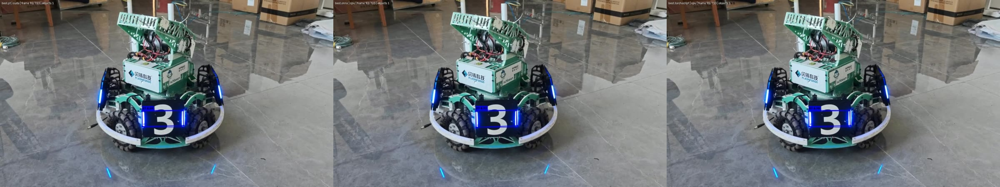

# YOLO 模型导出与推理性能对比（YOLO26n-pose 装甲板模型）

将上一次作业使用的 PyTorch 权重 `best.pt` 导出为 **ONNX** 与 **TorchScript** 两种格式，
用**同一段视频、同一批参数**分别推理，并从**模型大小、推理耗时、检出数量、检测效果**四个维度做对比。



---

## 1. 使用的 YOLO 模型版本

| 项目 | 内容 |
| --- | --- |
| 模型文件 | `best.pt`（5,892,455 B ≈ 5.62 MB） |
| 模型架构 | **YOLO26n-pose**（`yaml_file: yolo26n-pose.yaml`，`task=pose`） |
| 类别数 | 6 类：`B1, B2, B3, R1, R2, R3` |
| 关键点 | `kpt_shape = [4, 2]`（每个目标 4 个关键点，每个点 x,y） |
| 来源 | 课程统一提供（与第一次作业同一份权重） |
| 训练/导出环境 | ultralytics 8.4.175（模型由该版本保存） |

模型信息可用以下命令核验：

```bash
python -c "from ultralytics import YOLO;m=YOLO('weights/best.pt');print(m.task,m.names,m.model.kpt_shape)"
# pose {0: 'B1', 1: 'B2', 2: 'B3', 3: 'R1', 4: 'R2', 5: 'R3'} [4, 2]
```

## 2. 导出的模型格式与导出方法

使用 `export.py`（封装 ultralytics 的 `model.export()`）：

```bash
# ONNX（opset 12，静态 640×640，FP32，经 onnxslim 图简化）
python export.py --weights weights/best.pt --format onnx --imgsz 640 --opset 12

# TorchScript
python export.py --weights weights/best.pt --format torchscript --imgsz 640
```

**关键参数及选择理由**：

| 参数 | 取值 | 理由 |
| --- | --- | --- |
| `imgsz` | 640 | 与推理时一致；不同尺寸无法公平比较 |
| `opset` | 12 | 兼容性最好的常用算子集版本 |
| `simplify` | True | 用 onnxslim 折叠冗余节点，通常更快 |
| `batch` | 1 | 本次逐帧推理 |
| `dynamic` | False | 固定尺寸对性能最友好，也最公平 |
| `half` | False | 保持 FP32，与 `.pt` 同精度比较 |

导出产物（`models/`）：

| 文件 | 大小 | 说明 |
| --- | --- | --- |
| `best.onnx` | 9.74 MB | ONNX 计算图 + 权重 |
| `best.torchscript` | 9.95 MB | PyTorch 序列化的静态图模型 |

ONNX 结构核验（pose 模型的输出通道数可解释）：

```text
输入 images: [1, 3, 640, 640]
输出 output0: [1, 18, 8400]
  # 18 = 4(框 xywh) + 6(类别得分) + 8(4 个关键点 × 仅 (x, y)；本模型 kpt_shape=[4,2] 没有关键点置信度通道)
  # 8400 = 80² + 40² + 20²（640 输入下 stride 8/16/32 的网格数）
```

## 3. 运行环境与依赖

| 项目 | 版本 |
| --- | --- |
| 操作系统 | Ubuntu 22.04.5 LTS（WSL2，内核 `6.18.33.2-microsoft-standard-WSL2`） |
| Python | 3.10.12 |
| PyTorch | 2.11.0+cu128（torchvision 0.26.0+cu128） |
| ultralytics | 8.4.175 |
| onnx / onnxslim | 1.23.2 / 0.1.98 |
| onnxruntime | 1.23.2（CPU 版） |
| opencv-python | 5.0.0.93 |
| 硬件 | NVIDIA GeForce RTX 5060 Laptop GPU（8 GB）+ CPU：Intel Core Ultra 7 251HX |
| 依赖安装 | `pip install -r requirements.txt` + torch 用 CUDA 源单独装 |

## 4. 推理运行命令

```bash
# ① 原始 .pt（GPU）
python inference.py --model weights/best.pt        --device cuda --output results/pt/result_pt.mp4

# ② ONNX（CPU）
python inference.py --model models/best.onnx       --device cpu  --output results/onnx/result_onnx.mp4

# ③ TorchScript（CPU）
python inference.py --model models/best.torchscript --device cpu --output results/ts/result_ts.mp4
```

性能测量（预热 + 多轮平均 + 一致性对比）：

```bash
# A 组：CPU 上公平对比
python benchmark.py --device cpu --models models/best.onnx models/best.torchscript

# B 组：GPU 基线（如需对比 ONNX GPU，先装 onnxruntime-gpu）
python benchmark.py --device cuda --models models/best.onnx
```

输出：`results/bench.json`（原始数据）、`results/comparison_auto.md`（自动生成的表格）。

## 5. 原始模型与导出模型的推理结果截图

| 原始 `.pt`（GPU） | ONNX（CPU） | TorchScript（CPU） |
| --- | --- | --- |
|  |  |  |

三张截图取自同一时间点（第 3 秒），可见检测框、类别、置信度与 4 个关键点位置基本一致。

## 6. 模型大小、推理耗时与检测效果对比

> 测试条件：同一段视频均匀抽样 **73 帧**；`imgsz=640`、`conf=0.25`、`iou=0.7`；
> 每个模型预热 **10** 次后测量 **3** 轮取平均；CPU 组与 GPU 组分开比较。

| 对比项 | 原始 `.pt` | ONNX | TorchScript |
| --- | --- | --- | --- |
| 模型格式 | PyTorch checkpoint | ONNX（opset 12, FP32） | TorchScript（FP32） |
| 文件大小 | **5.62 MB** | **9.74 MB** | **9.95 MB** |
| 推理耗时（CPU，均值±标准差） | **34.40 ± 4.04 ms** | 76.03 ± 24.26 ms | 53.08 ± 7.08 ms |
| 推理耗时（GPU，均值） | 18.56 ms | 未测（需 onnxruntime-gpu） | **13.61 ms** |
| FPS（CPU / GPU） | **29.1** / 53.9 | 13.2 / —— | 18.8 / **73.5** |
| 检出目标数量（73 帧合计） | 112 | 109 | 113 |
| 与 `.pt` 的框匹配率（IoU≥0.5） | 基线 | 95.5% | **100.0%** |
| 关键点平均误差（px） | 0 | 2.47 | **0.33** |
| 检测效果 | `results/pt/frame_03s.jpg` | `results/onnx/frame_03s.jpg` | `results/ts/frame_03s.jpg` |

**结论**：

- **CPU 上 `.pt` 最快**（34.40 ms / 29.1 FPS），ONNX 反而最慢（76.03 ms，慢 2.21×），TorchScript 居中（53.08 ms）。
  ONNX 那行的标准差高达 24.26 ms（约 32%），说明测量期波动明显；再叠加"numpy→torch 转换做 NMS"的开销，
  以及 yolo26n 模型小、batch=1 时框架固定开销占比大，图优化收益被抵消。
- **GPU 上静态图收益明显**：TorchScript 比 eager `.pt` 快 **26.7%**（13.61 vs 18.56 ms，73.5 vs 53.9 FPS）。
- **精度等价**：TorchScript 框匹配率 100%、关键点误差 0.33 px；ONNX 匹配率 95.5%、误差 2.47 px，
  差异来自阈值边缘的 3 个框翻转与逐帧配对口径，截图肉眼无差别。
- 一句话：**导出是"图翻译"，但"换格式 ≠ 变快"，必须在目标硬件上实测。**

## 7. 实验过程中遇到的问题及解决方法

1. **问题**：导出 TorchScript 时报 `argument 'opset' is not supported for format='torchscript'`。
   **解决**：脚本原先把 `opset`（只对 ONNX 有意义）无条件传给所有格式，而 ultralytics 对"参数—格式"组合有严格校验；
   改为按格式维护**允许参数白名单**（`ALLOWED_ARGS`），只传递该格式支持的参数，其余打印提示后忽略。
2. **问题**：一开始把 pose 模型的 ONNX 输出通道数理解成 22。
   **解决**：实际输出是 `[1, 18, 8400]`——因为本模型 `kpt_shape=[4,2]`，每个关键点只有 (x, y)、**没有置信度通道**，
   所以是 4（框）+ 6（类别）+ 8（4 关键点 × 2）= 18；只有 `kpt_shape=[4,3]` 时才是 22。
3. **问题**：ONNX 在 CPU 上的耗时波动很大（标准差 24.26 ms，约 32%）。
   **解决**：加入 10 次预热、测量 3 轮共 219 次调用，并以**中位数**辅助判断（中位数 79.03 ms 与均值同量级），
   确认不是偶发尖峰；同时记录该波动作为"ONNX Runtime 在本机线程调度不够稳"的证据。
4. **问题**：一致性表格里 ONNX 与 TorchScript 两行的匹配率、关键点误差完全相同。
   **解决**：定位为脚本 bug——模型标签取 `Path(spec).stem`，两个模型都叫 `best`，导致统计字典键冲突；
   改用带扩展名的文件名（`best.onnx` / `best.torchscript`）作为标签后重跑，得到真实值（95.5% vs 100.0%）。
5. **问题**：ONNX 走 GPU 推理未测成。
   **解决**：CPU 版 `onnxruntime` 不含 CUDA Provider，需装 `onnxruntime-gpu`（依赖 CUDA 12 + cuDNN 9）；
   本次按"同硬件分组"原则，A 组统一在 CPU 上比较，已满足作业要求。

## 8. 对不同模型格式的理解与实验结论

**为什么导出的模型反而更大？**
`.pt` 是 PyTorch 的 checkpoint，以 zip 形式存储权重（压缩率较高）；ONNX 把**计算图 + 权重**序列化成 protobuf，
为了跨框架/跨运行时兼容，不做激进压缩，因此体积通常比 `.pt` 大。

**为什么本次 ONNX 在 CPU 上反而更慢？**
"ONNX Runtime 有图优化所以更快"只是一般规律，实测未必成立。本次 ONNX 均值 76.03 ms，而 `.pt` 是 34.40 ms，
ONNX 那行的标准差高达 24.26 ms（约 32%），说明测量期波动明显；再加上 ultralytics 走 onnxruntime 后端时，
输出要从 numpy 转回 torch 才能做 NMS（多一次跨库转换），而 yolo26n 模型很小、batch=1 时框架固定开销占比大，
图优化带来的收益被抵消。**结论：换格式不等于变快，必须在目标硬件上实测。**

**为什么两种格式的检测结果几乎一致？**
导出是**图翻译**而不是重新训练，数学上等价；细微差异来自浮点运算顺序和后端实现（通常小于 1e-3，
对框和关键点的影响在亚像素级）。本次实测 TorchScript 框匹配率 **100.0%**、关键点误差 0.33 px；
ONNX 为 95.5% / 2.47 px——差异集中在 `conf=0.25` 阈值边缘的 3 个框翻转，以及多目标帧里的配对口径，而非关键点位置出错。

**TorchScript 的定位**：把 Python 动态图"冻结"成静态图，去掉 Python 解释层开销，
便于不依赖源码部署；但它仍在 PyTorch 运行时中执行，缺少 ONNX Runtime / TensorRT 那类跨框架深度优化，
所以在 CPU 上通常与 `.pt` 持平或略快。

**TensorRT 为什么快（本次选做/未做）**：它会针对具体 GPU 做逐层核选择与层融合，
并可使用 FP16/INT8 量化，生成专用 `.engine`；代价是**引擎与 GPU 型号、CUDA/TensorRT 版本强绑定**，
换设备必须重新构建。

**结论**：
- 追求**跨平台/易部署** → ONNX 最合适（CPU 端通常还能顺带提速）；
- 只在 **PyTorch 生态内**部署、不想引入新运行时 → TorchScript 足够；
- 追求**极致 GPU 吞吐**且能固定硬件 → TensorRT 值得投入（但要付出构建与版本管理成本）。

## 目录结构

```text
yolo-export-inference/
├── README.md
├── requirements.txt
├── .gitignore
├── export.py               # .pt → onnx / torchscript / engine / openvino
├── inference.py            # 统一推理（--model 选格式）
├── benchmark.py            # 预热 + 多轮计时 + 一致性对比
├── weights/best.pt         # 原始权重（已提交）
├── models/
│   ├── best.onnx
│   └── best.torchscript
├── data/                   # 测试视频（未提交，见 .gitignore）
└── results/
    ├── comparison.md
    ├── comparison_auto.md
    ├── bench.json
    ├── pt/ onnx/ ts/       # 各格式结果视频与截图
```
