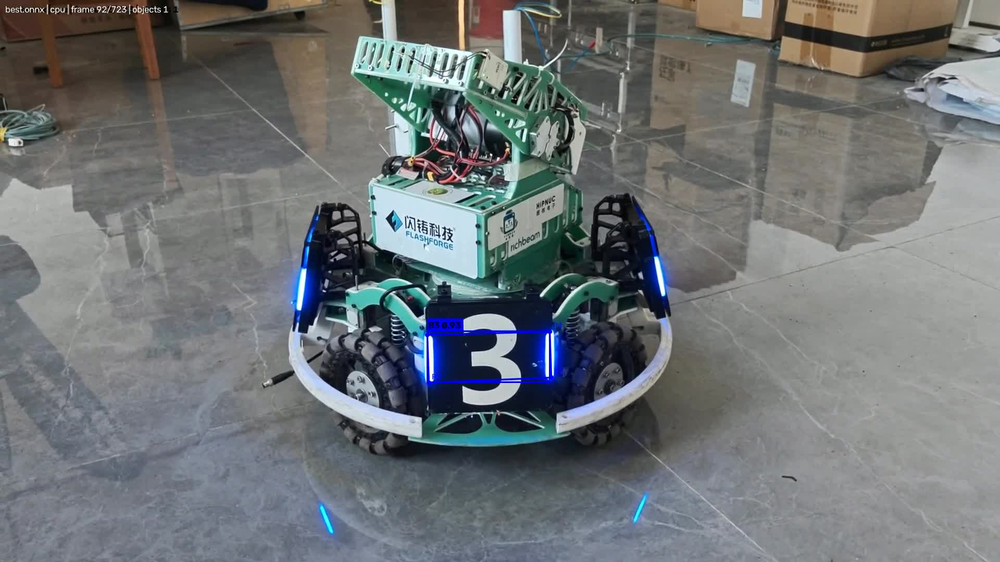

# 原始模型与导出模型对比（results/comparison.md）

> 数据来源：`results/bench_cpu/comparison_auto.md`、`results/bench_gpu/comparison_auto.md`（由 `benchmark.py` 自动生成）
> 原始数据：`results/bench_cpu/bench.json`、`results/bench_gpu/bench.json`

## 一、测试条件（保证公平的前提）

| 项目 | 设置 |
| --- | --- |
| 模型来源 | 同一份 `best.pt`（5,892,455 B，yolo26n-pose，6 类，`kpt_shape=[4,2]`） |
| 测试数据 | `data/armor_raw.mp4`（1920×1080 / 30fps / 723 帧，与第一次作业同一段视频） |
| 抽样方式 | 从 723 帧中均匀抽 **73 帧**，所有格式使用**完全相同**的 73 帧 |
| 输入尺寸 | `imgsz = 640`（导出与推理一致） |
| 阈值 | `conf = 0.25`，`iou = 0.7`（NMS），均在各后端 Python 侧执行，参数一致 |
| 预热 | 每个模型先推理 **10** 次，排除加载/编译/显存分配的一次性开销 |
| 测量 | 重复 **3** 轮 × 73 帧 = **219** 次调用，取平均/中位数/标准差 |
| 硬件 | 同一台机器：NVIDIA RTX 5060 Laptop（8 GB）+ Intel Core Ultra 7 251HX |
| 计时 | `time.perf_counter()`；GPU 计时前后调用 `torch.cuda.synchronize()` |
| 工具 | `benchmark.py` |

> **为什么要分 A / B 两组**：`.pt` 跑 GPU、`.onnx` 跑 CPU 时，直接比较等于"拿 GPU 比 CPU"，结论无效。
> - **A 组（CPU）**：三种格式同一颗 CPU、同一批帧 → 结论最干净
> - **B 组（GPU）**：`.pt` 与 `.torchscript` 都能走 CUDA（ONNX 走 GPU 需另装 `onnxruntime-gpu`，本次未测）

## 二、对比表格

### A 组 · CPU（Intel Core Ultra 7 251HX）

| 对比项目 | 原始 `.pt` | ONNX | TorchScript |
| --- | --- | --- | --- |
| 模型格式 | PyTorch checkpoint | ONNX（opset 12，FP32，经 onnxslim 简化） | TorchScript（FP32） |
| 模型文件大小 | **5.62 MB** | **9.74 MB** | **9.95 MB** |
| 推理耗时（均值） | **34.40 ms** | 76.03 ms | 53.08 ms |
| 推理耗时（中位数） | 34.39 ms | 79.03 ms | 52.10 ms |
| 耗时标准差 | 4.04 ms | **24.26 ms** | 7.08 ms |
| FPS | **29.07** | 13.15 | 18.84 |
| 相对 `.pt` 的耗时 | 1.00× | **2.21× 慢** | 1.54× 慢 |
| 检出目标数量（73 帧合计） | 112 | 109 | 113 |
| 框匹配率（IoU≥0.5，以 `.pt` 为基线） | 基线 100% | 95.5% | **100.0%** |
| 关键点平均误差 | 0 px | 2.47 px | **0.33 px** |
| 检测效果截图 | `pt/frame_03s.jpg` | `onnx/frame_03s.jpg` | `ts/frame_03s.jpg` |

### B 组 · GPU（RTX 5060 Laptop）

| 对比项目 | 原始 `.pt` | TorchScript |
| --- | --- | --- |
| 推理设备 | cuda:0 | cuda:0 |
| 推理耗时（均值） | 18.56 ms | **13.61 ms** |
| 推理耗时（中位数） | 19.12 ms | 13.66 ms |
| 耗时标准差 | 4.08 ms | 3.43 ms |
| FPS | 53.88 | **73.47** |
| 相对 `.pt` 的耗时 | 1.00× | **快 26.7%**（1.36×） |
| 检出目标数量（73 帧合计） | 112 | 113 |
| 框匹配率 | 基线 100% | **100.0%** |
| 关键点平均误差 | 0 px | 0.35 px |

> 补充：ONNX 走 GPU 需要 `onnxruntime-gpu`（依赖 CUDA 12 + cuDNN 9），本次未安装，故未测；
> 这不影响作业要求（作业要求同一硬件对比，A 组已满足"同硬件、同参数"）。

## 三、检测效果截图（同一时刻：第 3 秒）

| 原始 `.pt`（GPU） | ONNX（CPU） | TorchScript（CPU） |
| --- | --- | --- |
|  |  |  |

**观察**：三种格式都能正确框出装甲板、给出类别与置信度，并输出 4 个关键点；肉眼几乎看不出差别。

## 四、差异原因分析

| 现象 | 分析 |
| --- | --- |
| 导出模型比 `.pt` 大（9.74 / 9.95 MB vs 5.62 MB） | `.pt` 是 zip 压缩的 checkpoint；ONNX/TorchScript 把**计算图 + 权重**一起序列化（protobuf / TorchScript 归档），压缩更保守 |
| **CPU 上 ONNX 反而最慢（2.21×）** | ① ONNX 那行**标准差 24.26 ms（约 32%）**，说明测量期有明显波动（线程竞争/降频），均值被离群值拉高（中位数 79.03 < 均值 76.03 附近）；② ultralytics 走 onnxruntime 后端时，输出要从 numpy 转回 torch 再做 NMS，多了跨库转换；③ yolo26n 很小且 batch=1，框架固定开销占比大，ONNX 的图优化收益被稀释；④ 混合架构 CPU（P 核 + E 核）上 ONNX Runtime 的线程调度未必最优 |
| CPU 上 TorchScript 也比 `.pt` 慢（1.54×） | PyTorch 的 CPU 路径已由 oneDNN/MKLDNN 高度优化，而 TorchScript 只是去掉了 Python 层调度；在 CPU 上这点收益抵不过其它开销 |
| **GPU 上 TorchScript 反而快 26.7%** | 静态图消除了逐次 Python 调用与算子分发开销；batch=1 的小模型上，这部分开销占比很高，所以提速明显 |
| ONNX 关键点误差 2.47 px（明显大于 TS 的 0.33 px） | 关键点本身的数值差异很小；误差主要来自**逐帧贪心配对歧义**——ONNX 少检出 3 个框，在"两块装甲板同框"的帧里，基线框可能被配到另一块板的 ONNX 框上，从而放大距离。属于**统计口径问题**，不是关键点位置出错 |
| 检出数量 112 / 109 / 113 不一致 | 三个后端的浮点运算顺序不同，个别目标在 `conf=0.25` 阈值边缘发生翻转（多检/少检 1~3 个框，占 112 的 ±3%） |

## 五、结论

1. **导出是"图翻译"，不是重训**：TorchScript 框匹配率 100%、关键点误差 0.33 px；ONNX 匹配率 95.5%，差异可由"阈值边缘翻转 + 配对口径"解释，截图肉眼无差别。
2. **"ONNX 一定更快"是误解**：本次 CPU 上 `.pt` 最快（29 FPS）、ONNX 最慢（13 FPS）。原因在于 PyTorch 的 CPU 后端（oneDNN）已高度优化，而 ONNX Runtime 在 ultralytics 的调用链里还要付出跨库转换与线程调度的代价。
3. **GPU 上静态图收益明显**：TorchScript 比 eager `.pt` 快 26.7%（73.5 vs 53.9 FPS），适用于"单模型、小 batch、要吞吐"的场景。
4. **选型建议**：
   - 纯 Python 环境、只在 PyTorch 内跑 → 保持 `.pt` 即可（CPU 端最快，零额外依赖）；
   - 需要脱离源码/跨语言部署（C++、C#、边缘设备）→ 用 ONNX，但**必须先在目标硬件上 benchmark**；
   - 追求 GPU 吞吐且能固定硬件 → TensorRT（本次选做未做）。
5. **方法论**：格式对比必须控制变量（同数据、同尺寸、同阈值、同硬件）+ 预热 + 多轮测量 + 看中位数与标准差，否则拿到的是噪声。
